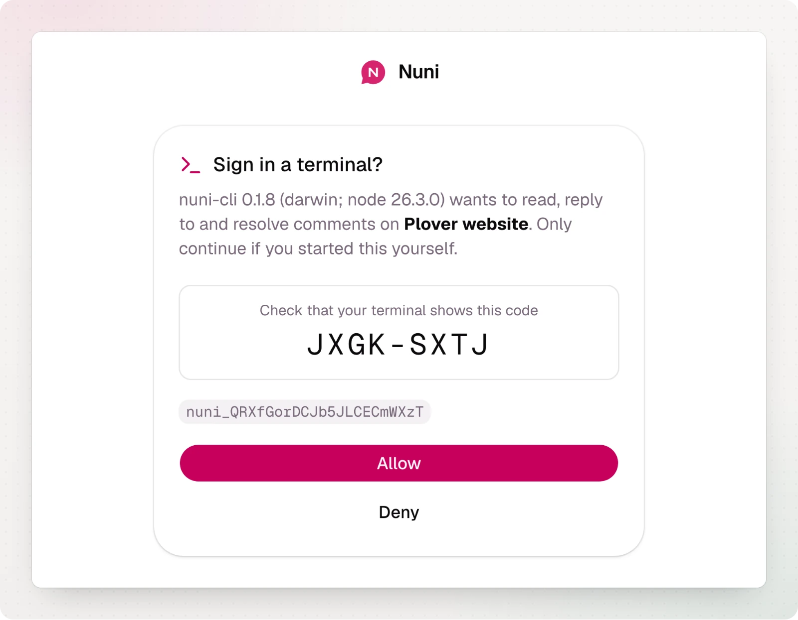
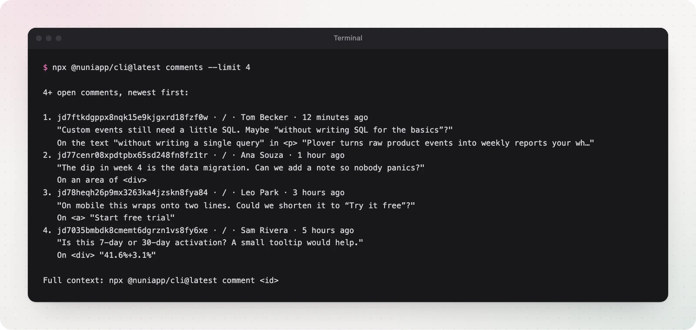

A comment in Nuni carries the context an agent needs: the page, the element (text, selectors, React component), its markup and styles, console errors, failed requests and a screenshot. When the commenter suggested an edit, it includes the exact old and new text too. There are three ways to hand it over.

## Copy for agent

Open a comment in the widget (as the owner) or in the dashboard and choose **Copy for agent**. Paste it into your agent. Nothing to install.

## Sign in once

The CLI and the MCP server read comments as the project owner. Sign in from the project folder:

```bash
{{cli}} login
```

It prints a link and a short code. Open the link (on any device), check that the code matches, and choose **Allow**. If nobody owns the project yet, you claim it at the same time. This works over SSH and in cloud sandboxes, since nothing has to call back to your machine.



The session is saved for {{cli-session-days}} days in `credentials.json`, readable only by you, in `~/.config/nuni` (or `$XDG_CONFIG_HOME/nuni`, or `%APPDATA%\nuni` on Windows). The project is the `nuni_` ID in your code; pass `--project nuni_...` if there is more than one. In CI, set `NUNI_TOKEN` instead. Sign out with `{{cli}} logout`, or revoke the session in the project settings in the dashboard.

## MCP server

Add Nuni to your agent once. It runs `{{cli}} mcp` in your project folder.

<Tabs>
  <Tab title="Claude Code">
    ```bash
    {{mcp-add}}
    ```
  </Tab>
  <Tab title="Cursor">
    ```json .cursor/mcp.json
    {
      "mcpServers": {
        "nuni": { "command": "npx", "args": ["-y", "{{cli-package}}@latest", "mcp"] }
      }
    }
    ```
  </Tab>
  <Tab title="Codex">
    ```toml ~/.codex/config.toml
    [mcp_servers.nuni]
    command = "npx"
    args = ["-y", "{{cli-package}}@latest", "mcp"]
    ```
  </Tab>
  <Tab title="Other">
    Any MCP client with stdio servers: the command is `npx`, the arguments are `-y {{cli-package}}@latest mcp`. Add `--project nuni_...` if the agent doesn't start in your project folder.
  </Tab>
</Tabs>

Then ask your agent something like _"fix the open Nuni comments"_. The tools:

| Tool               | What it does                                                                                      |
| ------------------ | ------------------------------------------------------------------------------------------------- |
| `list_comments`    | Open (or resolved) comments, newest first, optionally for one page and grouped by page or element |
| `search_comments`  | Comments with these words in them or from this author, best match first                           |
| `list_pages`       | The pages with open comments, and how many each has                                               |
| `get_comment`      | One comment with all of its context, plus the screenshot as an image                              |
| `reply_to_comment` | Reply in the thread, as the owner                                                                 |
| `resolve_comment`  | Resolve it, optionally with a note saying what changed                                            |
| `resolve_comments` | Resolve up to {{bulk-max}} at once, for example everything one change fixed                       |
| `reopen_comment`   | Reopen it                                                                                         |

Grouping helps with requests like _"fix all the comments on /pricing"_: comments on the same element (the same button, heading or sentence) are listed together, so one change can fix them all.

If the agent isn't signed in, the tools say so and ask you to run `login`.

## From the terminal

```bash
{{cli}} comments                  # open comments, newest first
{{cli}} comments --page /pricing  # one page
{{cli}} comments --search "typo"  # best match first
{{cli}} comments --group element  # related comments together
{{cli}} pages                     # pages with open comments
{{cli}} comment <id>              # everything about one comment
{{cli}} comment <id> --save-screenshot .
{{cli}} reply <id> "Fixed in the next deploy"
{{cli}} resolve <id> --note "Made the button bigger"
{{cli}} resolve <id> <id> --note "Fixed both typos"
{{cli}} reopen <id> --note "Still wrong on mobile"
```



Add `--json` to any command for machine-readable output; the [CLI reference](/reference/cli#json-output) lists the shapes.
